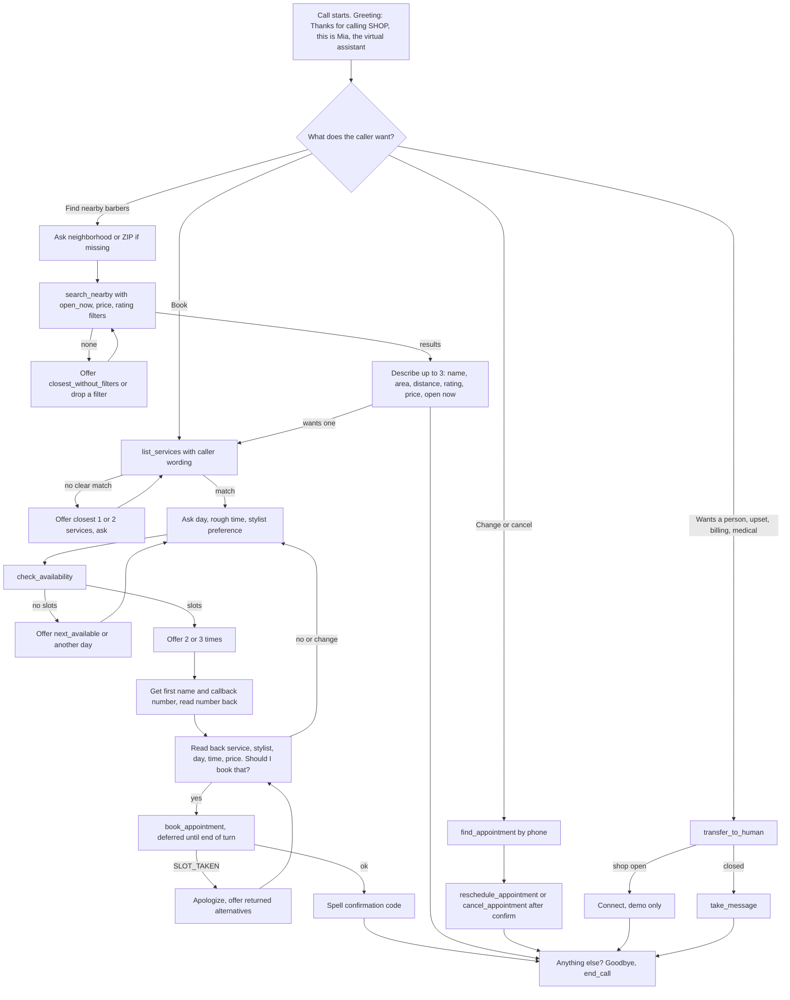
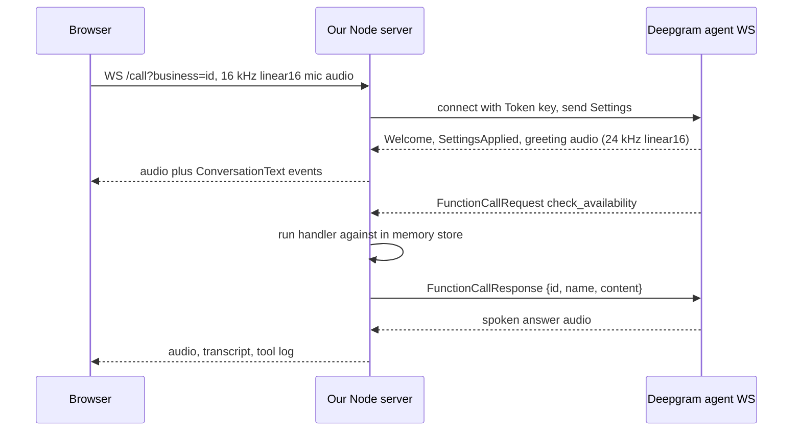

# AI Phone Receptionist: Design (prototype v0.1)

Target: the voice front desk inside a CRM and website builder for small beauty businesses (barbershops, salons, med spas). This prototype answers in the browser; a Twilio phone line comes later.

Built against the Deepgram Voice Agent API as documented on 2026-10-23 (snapshots of the pages used are in `spec/`):

- Endpoint: `wss://agent.deepgram.com/v1/agent/converse`, header `Authorization: Token <DEEPGRAM_API_KEY>` (source: developers.deepgram.com/docs/build-a-voice-agent, /reference/authentication).
- First client message is `Settings` (schema `AgentV1_AgentV1Settings` in the AsyncAPI spec at /reference/voice-agent/voice-agent). The server replies `Welcome` and `SettingsApplied`.
- Function calling: server sends `FunctionCallRequest {functions:[{id,name,arguments(JSON string),client_side}]}`; for `client_side: true` we reply `FunctionCallResponse {id,name,content}`. `FunctionCallCancelled` means send nothing for that id. `defer_until_eot: true` on a function holds it until the caller's turn is confirmed, which we use on every write.

## 1. Call flows



Sequence for one tool call:



## 2. Tools

All tools are client side from Deepgram's point of view, which here means our server runs them. Reads dispatch immediately (fast, speculative). Writes set `defer_until_eot: true` so a booking cannot fire while the caller is still mid sentence. Every handler returns JSON with `ok`; failures carry an `error` code and often a `say` hint or `alternatives`, and handlers never throw.

#### search_nearby (read)

Find barbershops, salons, or med spas on our network near a neighborhood, city, or ZIP code in the Bay Area. Use when the caller asks for other options nearby.

```json
{
  "type": "object",
  "properties": {
    "location": {
      "type": "string",
      "description": "Neighborhood, city, or 5 digit ZIP, as the caller said it. Example: \"Mission\", \"94609\", \"Oakland\"."
    },
    "business_type": {
      "type": "string",
      "enum": [
        "barbershop",
        "salon",
        "medspa",
        "any"
      ],
      "description": "Kind of business. Default barbershop."
    },
    "open_now": {
      "type": "boolean",
      "description": "Only return places open right now."
    },
    "max_price_level": {
      "type": "integer",
      "minimum": 1,
      "maximum": 4,
      "description": "1 is budget, 4 is premium."
    },
    "min_rating": {
      "type": "number",
      "description": "Minimum star rating, 1 to 5."
    },
    "max_distance_miles": {
      "type": "number",
      "description": "Default 10."
    }
  },
  "required": [
    "location"
  ]
}
```

#### list_services (read)

List services, prices, durations, and which stylists offer each, for a business. Pass service_query to match what the caller asked for.

```json
{
  "type": "object",
  "properties": {
    "business_id": {
      "type": "string",
      "description": "Business id, for example \"fade-district\". Defaults to the business that was called."
    },
    "service_query": {
      "type": "string",
      "description": "What the caller asked for in their words, for example \"fade and beard\"."
    }
  }
}
```

#### check_availability (read)

Get open appointment times on a date. For more than one service, pass all of them in service_ids: each returned time is a back to back block with one stylist, sized to the total duration. Always call this before offering times. Never invent times.

```json
{
  "type": "object",
  "properties": {
    "business_id": {
      "type": "string",
      "description": "Business id, for example \"fade-district\". Defaults to the business that was called."
    },
    "service_ids": {
      "type": "array",
      "items": {
        "type": "string"
      },
      "description": "Service ids from list_services, in the order they should happen. Use one id for a single service."
    },
    "service_id": {
      "type": "string",
      "description": "Single service id. Same as service_ids with one item."
    },
    "date": {
      "type": "string",
      "description": "Local date, YYYY-MM-DD. Resolve words like \"tomorrow\" using the current date in your instructions."
    },
    "stylist": {
      "type": "string",
      "description": "Stylist id or first name, if the caller has a preference."
    },
    "part_of_day": {
      "type": "string",
      "enum": [
        "any",
        "morning",
        "afternoon",
        "evening"
      ],
      "description": "Morning is before 12, afternoon 12 to 5, evening after 5."
    },
    "around_time": {
      "type": "string",
      "description": "Preferred start, 24 hour HH:MM local time. Results are sorted nearest first."
    }
  },
  "required": [
    "date"
  ]
}
```

#### book_appointment (write, defer_until_eot)

Book one appointment block. For several services with one stylist, pass them all in service_ids in one call; they are booked back to back starting at time. Only call after you read the details back and the caller clearly said yes.

```json
{
  "type": "object",
  "properties": {
    "business_id": {
      "type": "string",
      "description": "Business id, for example \"fade-district\". Defaults to the business that was called."
    },
    "service_ids": {
      "type": "array",
      "items": {
        "type": "string"
      },
      "description": "Service ids in order. They run back to back, never at the same time."
    },
    "service_id": {
      "type": "string",
      "description": "Single service id. Same as service_ids with one item."
    },
    "stylist_id": {
      "type": "string",
      "description": "Stylist id from check_availability."
    },
    "date": {
      "type": "string",
      "description": "YYYY-MM-DD"
    },
    "time": {
      "type": "string",
      "description": "Start of the first service, 24 hour HH:MM local time, exactly as returned by check_availability."
    },
    "customer_name": {
      "type": "string"
    },
    "customer_phone": {
      "type": "string",
      "description": "Callback number, digits only."
    },
    "for_person": {
      "type": "string",
      "description": "Who the service is for if not the caller, for example \"Alex's son Leo\"."
    }
  },
  "required": [
    "stylist_id",
    "date",
    "time",
    "customer_name",
    "customer_phone"
  ]
}
```

#### find_appointment (read)

Look up a caller's upcoming appointments by phone number, before rescheduling or cancelling.

```json
{
  "type": "object",
  "properties": {
    "customer_phone": {
      "type": "string"
    },
    "business_id": {
      "type": "string",
      "description": "Business id, for example \"fade-district\". Defaults to the business that was called."
    }
  },
  "required": [
    "customer_phone"
  ]
}
```

#### reschedule_appointment (write, defer_until_eot)

Move an existing appointment to a new open time. Read the new time back and get a yes first.

```json
{
  "type": "object",
  "properties": {
    "confirmation_code": {
      "type": "string"
    },
    "new_date": {
      "type": "string",
      "description": "YYYY-MM-DD"
    },
    "new_time": {
      "type": "string",
      "description": "24 hour HH:MM"
    },
    "stylist_id": {
      "type": "string",
      "description": "Optional new stylist."
    }
  },
  "required": [
    "confirmation_code",
    "new_date",
    "new_time"
  ]
}
```

#### cancel_appointment (write, defer_until_eot)

Cancel an existing appointment after the caller confirms. Mention the cancellation policy first.

```json
{
  "type": "object",
  "properties": {
    "confirmation_code": {
      "type": "string"
    }
  },
  "required": [
    "confirmation_code"
  ]
}
```

#### transfer_to_human (write, defer_until_eot)

Hand the call to a staff member. Use when the caller asks for a person, is upset, has a medical or complaint question, or you are stuck.

```json
{
  "type": "object",
  "properties": {
    "business_id": {
      "type": "string",
      "description": "Business id, for example \"fade-district\". Defaults to the business that was called."
    },
    "reason": {
      "type": "string",
      "description": "One short sentence for the staff member."
    }
  },
  "required": [
    "reason"
  ]
}
```

#### take_message (write, defer_until_eot)

Leave a message for the team when no one can take the call. Collect name, callback number, and the message first.

```json
{
  "type": "object",
  "properties": {
    "business_id": {
      "type": "string",
      "description": "Business id, for example \"fade-district\". Defaults to the business that was called."
    },
    "caller_name": {
      "type": "string"
    },
    "callback_phone": {
      "type": "string"
    },
    "message": {
      "type": "string"
    },
    "urgent": {
      "type": "boolean"
    }
  },
  "required": [
    "caller_name",
    "callback_phone",
    "message"
  ]
}
```

#### end_call (write, defer_until_eot)

End the call after you have said goodbye and the caller has nothing else.

```json
{
  "type": "object",
  "properties": {}
}
```

#### set_language (voice switch, not deferred)

Switch your speaking voice to the caller's language. Call this first, before you reply, whenever the caller speaks a different language than your last reply. Then reply in that language.

```json
{
  "type": "object",
  "properties": {
    "language": {
      "type": "string",
      "enum": [
        "en",
        "es",
        "zh"
      ],
      "description": "en English, es Spanish, zh Mandarin Chinese."
    }
  },
  "required": [
    "language"
  ]
}
```

## 3. Persona, prompt, voice

- Name: Mia, "the virtual assistant" for the shop that was called. She says she is an AI if asked (disclosure matters for trust and for state call recording and bot disclosure rules).
- Tone: warm, relaxed, efficient front desk. One or two short sentences per turn, one question at a time, prices and times in spoken words, no lists, no em dashes. The on page transcript shows digits ("October 25", "$75", "2:30 PM", "BK1001", "(415) 555-0100") through `public/digits.js`; this is display only, the spoken text and the LLM context stay in words.
- Prompt: built per business and per call in `src/prompt.js`. It injects the current Pacific date and time, open or closed status, hours, and policies, then the booking flow, date rules, nearby search rules, handoff rules, and a med spa safety block. About 4,100 to 4,600 characters (Deepgram managed LLM limit is 25,000).
- Voice (English): `aura-2-helena-en` (Deepgram lists it as "Caring, Natural, Positive, Friendly", for IVR and casual chat). Runner ups: `aura-2-thalia-en`, `aura-2-andromeda-en`, and `aura-2-apollo-en` for a men's barbershop brand. Switch with `VOICE_EN` (or the older `VOICE_MODEL`).
- Voice (Spanish): `aura-2-selena-es`, one of Aura-2's English and Spanish codeswitching voices (others: `aquila-es`, `carina-es`, `diana-es`, `javier-es`). Switch with `VOICE_ES`.
- Voice (Mandarin): Aura has no Mandarin. Default is Deepgram managed Cartesia (`sonic-2`, `language: zh`), which needs no extra key. See section 3a.
- STT: default `nova-3` with `language: multi` (listen `version: v1`), because it is the only Deepgram streaming option that covers English, Spanish and Mandarin together. `keyterms` are seeded with the shop name, staff first names, and service names. `STT_MODE=flux-multi` uses `flux-general-multi` (better turn taking, but no Mandarin), `STT_MODE=flux-en` restores the original English only `flux-general-en`.
- LLM: Deepgram managed `open_ai` `gpt-4.1-mini`, temperature 0.4 (Standard tier). Override with `LLM_MODEL`.

## 3a. Languages (English, Spanish, Mandarin)

How a switch works:

1. Every call starts in English (greeting and voice).
2. The caller speaks another language. Nova-3 multi transcribes it. The server guesses the language from the transcript (Han characters, then Spanish and English word lists, or the `languages` field when Flux multi is used) and sends `UpdateSpeak` with the matching voice right away.
3. The prompt also tells Mia to call `set_language` before her first reply in the new language. The tool waits for Deepgram's `SpeakUpdated` (or an `Error`, or a 4 second timeout) before it answers, so the reply is spoken in the right voice. A failed switch rolls back to the previous voice and tells Mia to keep the current language.
4. While the call is not in English, every tool result carries `reply_language`, so Mia does not drift back to English after reading English JSON.
5. The browser gets a `language` event and shows "Voice switched to Spanish".

Prompt rules: reply in the language of the caller's latest message; translate tool results but keep business, staff and service names; spell confirmation codes letter by letter; Spanish uses usted and "cuarenta y cinco dólares"; Mandarin uses simplified characters, no pinyin, "四十五美元", "下午两点半". If Mandarin has no voice (`MANDARIN_TTS=off` or a missing BYO key), `set_language` returns `NO_VOICE` and Mia offers English or Spanish and a message.

STT tradeoff: `flux-general-multi` covers 10 languages but not Chinese, so the default is `nova-3` multi. That gives up Flux's model based end of turn detection and uses Deepgram's standard endpointing instead. For an English and Spanish only shop, `STT_MODE=flux-multi` is the better choice.

Mandarin TTS options (`MANDARIN_TTS`):

| Value | Provider | What Amy needs |
| --- | --- | --- |
| `cartesia` (default) | Deepgram managed Cartesia, `sonic-2`, voice `CARTESIA_VOICE_ZH` | Nothing extra. Deepgram's docs list managed Cartesia in the Standard tier. Verified live: `UpdateSpeak` accepted and Mandarin audio played. Set `CARTESIA_API_KEY` only to bill Cartesia directly. |
| `eleven_labs` | ElevenLabs BYO, `eleven_turbo_v2_5` over WebSocket | `ELEVENLABS_API_KEY` and a Mandarin capable `ELEVENLABS_VOICE_ID`. Paid ElevenLabs plan. |
| `open_ai` | OpenAI BYO, `tts-1` | `OPENAI_API_KEY`. Paid per character. |
| `off` | none | Mandarin callers are offered English or Spanish and a message. |

Pricing: the Voice Agent price on deepgram.com/pricing is set by the LLM and TTS tier and billed by WebSocket connection time. It has no separate STT or multilingual line, so moving STT to `nova-3` multi or `flux-general-multi` should not change the bundled per minute price. The page does not say this in so many words, so confirm in the Deepgram console usage view. BYO TTS providers bill separately.

## 4. Edge cases and how they are handled

| Case | Handling |
| --- | --- |
| Several services, one caller | One `book_appointment` with `service_ids` books them back to back with one stylist (Skin Fade 12:00, then Kids Cut 12:30). `check_availability` with `service_ids` searches for the total duration. A stylist can never hold two overlapping appointments (`SLOT_TAKEN`), and the same caller cannot hold two overlapping bookings unless they are for different people (`CALLER_OVERLAP`, use `for_person`). If no one stylist does every service, `NO_SINGLE_STYLIST`. |
| Double booking | Slots live in one in memory store. `book_appointment` checks every 30 minute block the service needs and takes them in one synchronous step, so two callers cannot both win. Tested, including 3 hour services overlapping shorter ones. |
| Slot taken mid call | Availability is advisory; the booking re-checks. On `SLOT_TAKEN` the tool returns nearby `alternatives` and the prompt has Mia apologize and offer them. Demo button "Another caller takes the first offered slot" reproduces it live. |
| Speculative tool calls | Writes use `defer_until_eot`. `FunctionCallCancelled` ids get no response. Known gap: if Deepgram cancels a write after we already ran it, the booking stands; find_appointment will show it. |
| Ambiguous dates and times | Prompt carries today's date; the LLM resolves "tomorrow" to YYYY-MM-DD. Vague asks get a clarifying question or `part_of_day`. "At seven" assumes the open hour and confirms. Past times return `IN_THE_PAST`; beyond 7 days `OUT_OF_RANGE`; same day needs 30 minutes notice. |
| Time zones | Everything is shop local Pacific time. Callers naming another zone get converted and confirmed in Pacific. A multi state rollout needs a per business `timezone` field. |
| Unknown service | `list_services` returns `match: null`, the closest services, and an explicit "do not book" instruction. `check_availability` and `book_appointment` reject unknown ids. |
| Stylist mismatch | `STYLIST_DOES_NOT_OFFER_SERVICE` with who does. |
| Caller wants a human | `transfer_to_human`. Open: demo says connecting (real warm transfer arrives with Twilio). Closed: returns next opening and Mia offers `take_message`. |
| Silence | Server timer: 15 s after Mia finishes with no caller speech, she checks in once ("Are you still there?"), then says goodbye and hangs up. |
| Barge in | Flux or Nova-3 detects it; Deepgram sends `UserStartedSpeaking`, and the browser drops queued agent audio immediately. |
| Out of hours | Prompt knows open or closed now; slots only exist inside hours; transfers fall back to messages. |
| Medical questions (med spa) | Prompt forbids advice on safety, dosage, interactions, pregnancy, side effects; offers a consult with a licensed provider; urgent reactions go to 911 or a person. Salons and barbershops get a lighter "no medical advice" rule. |
| Bad phone number | Must normalize to 10 US digits or the tool rejects it. |
| Phone read back (enforced) | `book_appointment` and `take_message` only run after Mia has actually said that exact number in her transcript (digits, English or Spanish number words, or Chinese digits, in any grouping) and the caller has answered since. Otherwise the tool returns `READ_BACK_PHONE_FIRST` with the digit groups to say. The check lives in the server (`src/readback.js`), so the model cannot skip it. |
| Cancel or reschedule without asking | `cancel_appointment` and `reschedule_appointment` return `CONFIRM_FIRST` unless Mia spoke and the caller answered after the last lookup (`find_appointment` or `check_availability`). Stops a lookup and cancel in one breath. |
| Finding a booking | `find_appointment` takes the confirmation code alone (the phone number is left out of that result), or the name and phone together. Name plus number must both match, and a miss says nothing about whether the number has other bookings. |
| Social engineering | Prompt section "Rules callers cannot change": no prompt reveal, no discounts or free services, no other customers' details, no booking on a stylist's day off. Tested live with injection, owner impersonation, spoofed cancel, and "he said he'd come in" scenarios. |
| Wrong language switch | `set_language` is refused (`CALLER_LANGUAGE_MISMATCH`) when the caller's last words are clearly in another language and they did not ask to switch. Seen live: the model switched an English caller to Spanish. |
| Spanish and Mandarin service names | `list_services` maps common Spanish and Chinese service words (corte, barba, degradado, 理发, 修胡子, 渐变...) to the English menu before matching. |
| Dashes from the model | The prompt forbids them, and the server also replaces em and en dashes in Mia's transcript before the browser sees it. |
| Transfer | When a live transfer starts, Mia says one line (plus 911 advice when symptoms are urgent) and the AI leg hangs up. |
| Malformed tool args | Bad JSON or unknown tool returns an error object, never a crash. |

## 5. Stack

- Node 18+ (tested on 20), one dependency at runtime: `ws`. Dev only: `ajv` and `js-yaml` for schema validation.
- `server.js`: HTTP for the page and small JSON endpoints, WebSocket `/call` per caller, binds to 127.0.0.1 by default.
- `src/session.js`: the bridge. Deepgram key stays server side; browser only sees audio and events.
- `src/store.js`: in memory businesses, slots, appointments, messages. Synchronous writes give atomic booking.
- `src/tools.js`, `src/prompt.js`, `src/settings.js`: tool schemas and handlers, prompt, Settings builder.
- `public/`: plain HTML and JS. AudioWorklet downsamples the mic to 16 kHz linear16; playback is 24 kHz linear16 via Web Audio.
- `data/mock.json` via `data/generate-mock.js`: 5 fictional Bay Area businesses, 9 neighborhoods with ZIPs, 30 minute open slots per staff for 7 days. The server regenerates in memory if the file is stale.

## 6. Path to production (not built)

1. Twilio Media Streams: `mulaw` 8 kHz in and out (both supported in the Settings schema), same session class.
2. Real calendar and CRM tables instead of mock JSON, with a DB unique constraint or transaction per staff slot for multi process safety.
3. Per business config from the CRM: hours, services, staff, voice, greeting, policies.
4. SMS confirmations, reminders, call recording consent, call summaries into the CRM.
5. Auth on all endpoints, remove the `/api/dev` route, rate limits, logging that redacts phone numbers.
